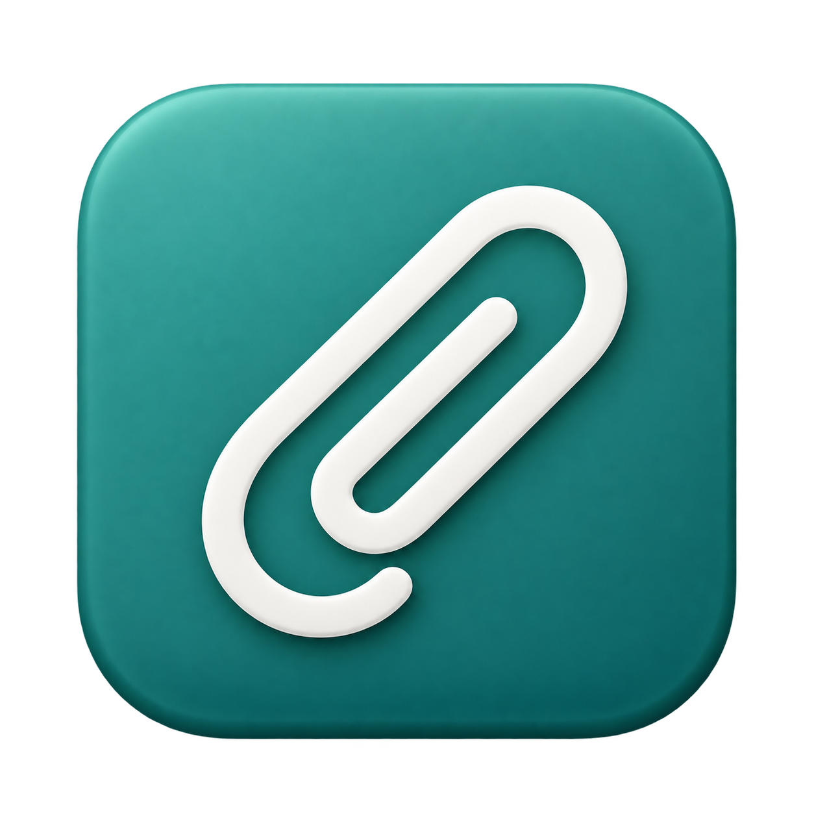
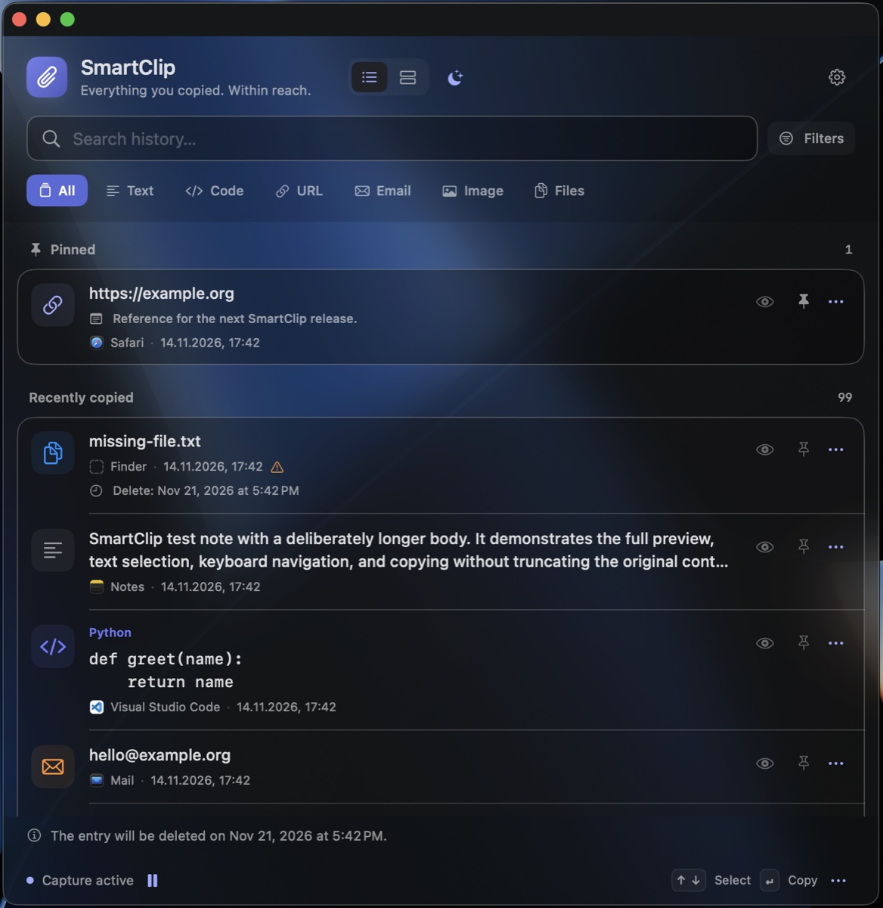
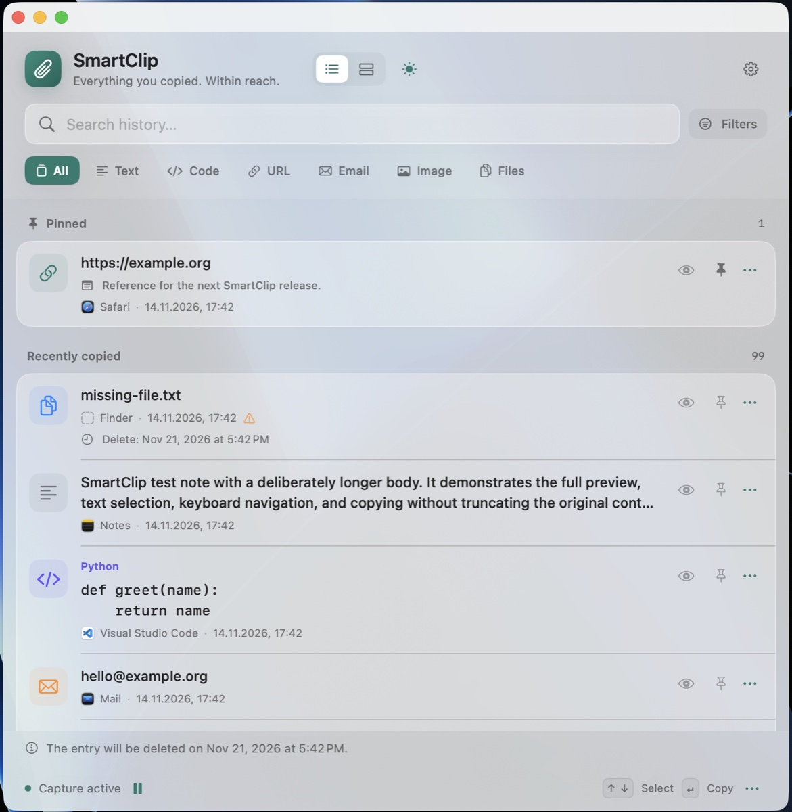
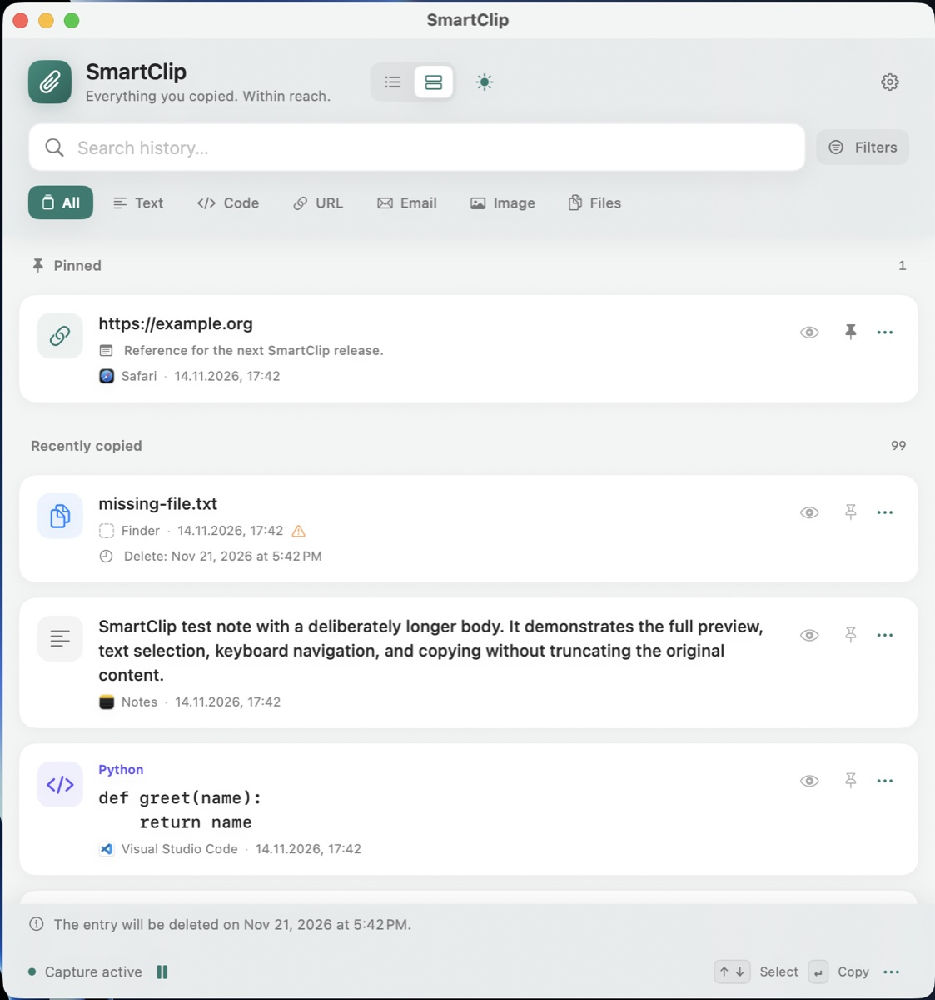
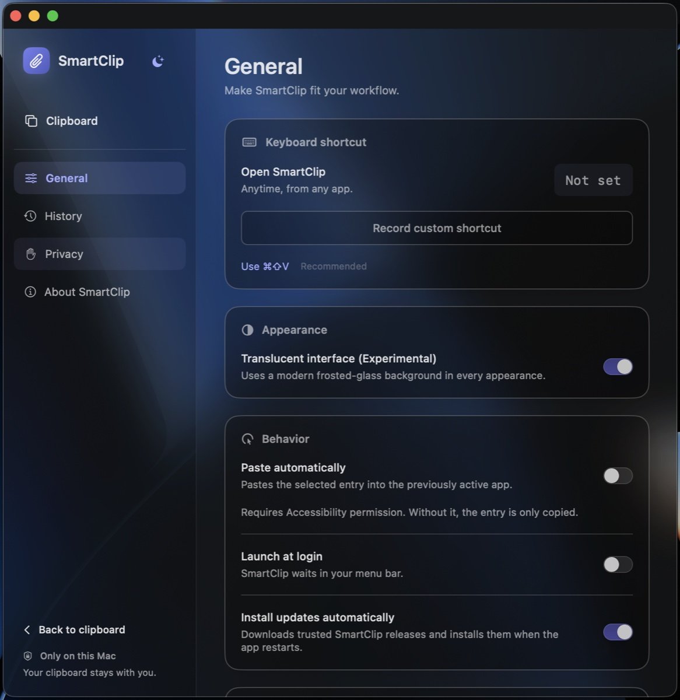
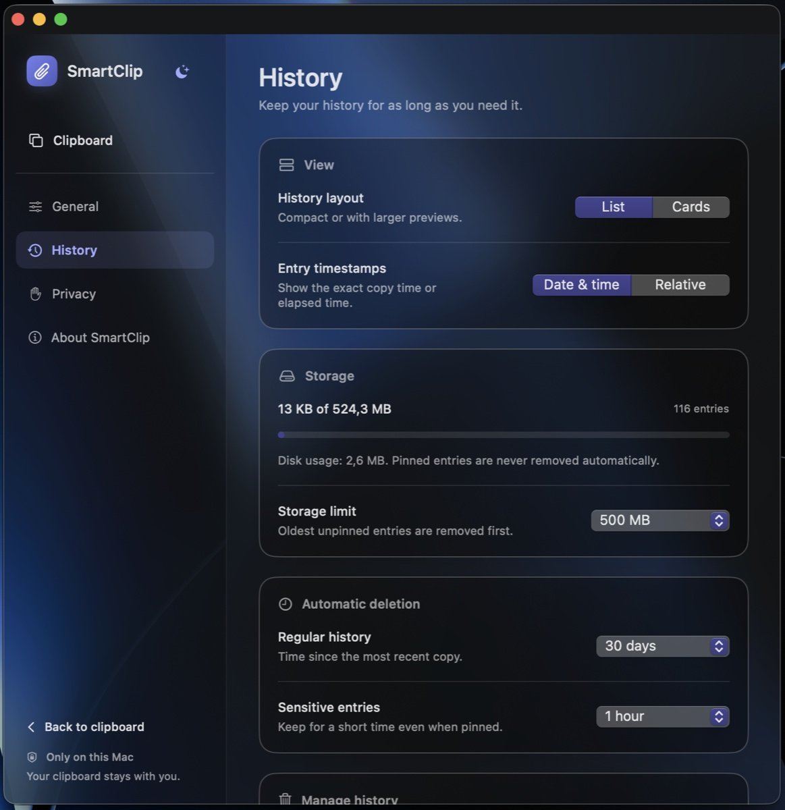
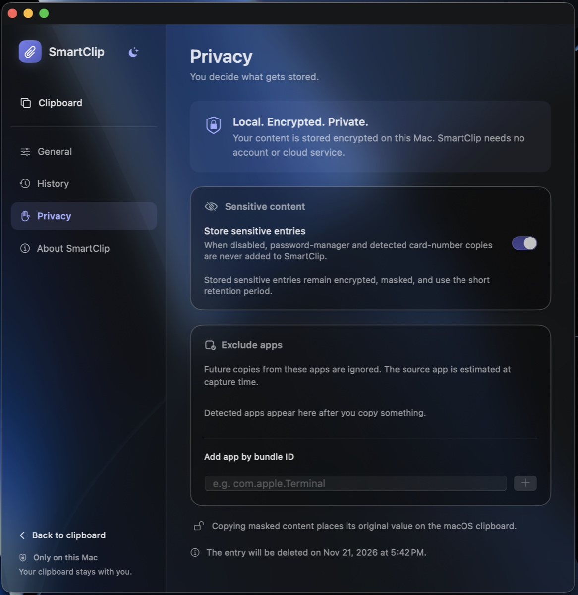
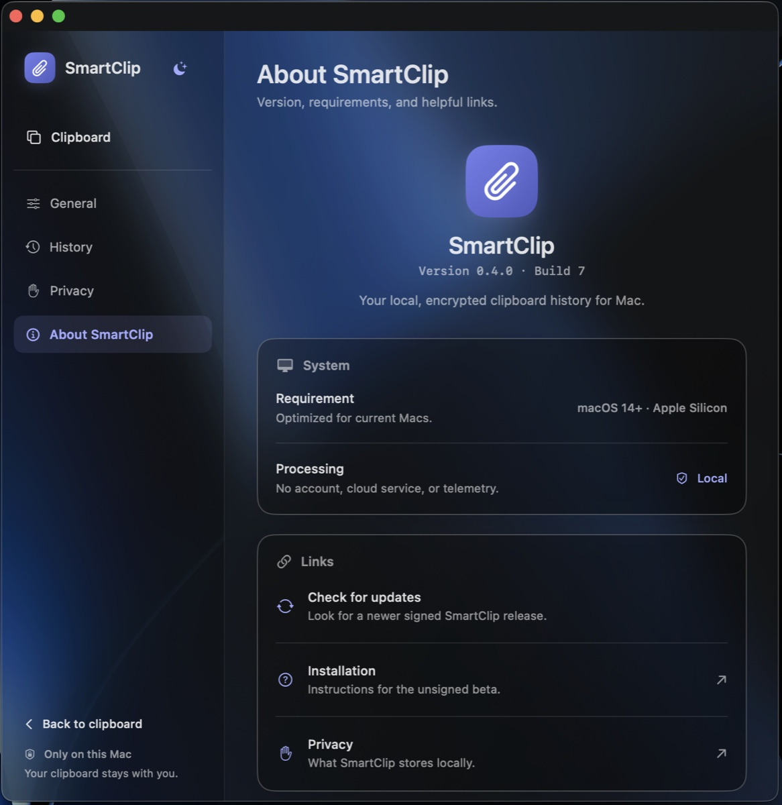

# SmartClip

<p align="center">
  <a href="README.md">English</a> · <strong>Deutsch</strong> · <a href="README-ZH.md">中文</a> · <a href="README-JA.md">日本語</a> · <a href="README-KO.md">한국어</a>
</p>

<div align="center">
  

  **Ein privater, verschlüsselter Zwischenablageverlauf, der sich auf macOS zu Hause fühlt.**

  [](https://github.com/reathloo/smartClip/actions/workflows/ci.yml)
  [](https://github.com/reathloo/smartClip/releases)
  
  
  [](LICENSE)

  [Screenshots](#screenshots) · [Funktionen](#funktionen) · [Installation](#installation) · [Datenschutz](#datenschutz-by-design) · [Entwicklung](#entwicklung) · [Mitwirken](CONTRIBUTING.md) · [Sicherheit](SECURITY.md)
</div>

SmartClip lebt in der Menüleiste und hält kopierte Texte, Links, Code, Bilder und
Dateiverweise griffbereit. Alles bleibt auf deinem Mac: kein Konto, kein
Cloud-Dienst, keine Telemetrie und keine externe Verarbeitung.

## Screenshots

SmartClip unterstützt helle und dunkle Darstellungen, Listen- und
Kartenansichten sowie eine optionale experimentelle transparente Oberfläche.

<p align="center">
  
</p>

| Helle Listenansicht | Helle Kartenansicht |
| --- | --- |
|  |  |

| Allgemeine Einstellungen | Verlaufseinstellungen |
| --- | --- |
|  |  |

| Datenschutzeinstellungen | Über SmartClip und Updates |
| --- | --- |
|  |  |

## Warum SmartClip?

- **Standardmäßig privat.** Inhalte der Zwischenablage werden mit AES-GCM
  verschlüsselt; der Schlüssel wird im macOS-Schlüsselbund gespeichert.
- **Schnell erreichbar.** Öffne den Verlauf über die Menüleiste oder ein
  konfigurierbares globales Tastenkürzel und suche und kopiere, ohne deinen
  Arbeitsablauf zu verlassen.
- **Nativ auf macOS.** Entwickelt mit SwiftUI und AppKit, mit heller und dunkler
  Darstellung, automatischem Start, nativer Tastaturbedienung und Einfügen
  unter Berücksichtigung der Bedienungshilfen.
- **Mehrsprachige Oberfläche.** Folgt der bevorzugten macOS-App-Sprache auf
  Englisch, Deutsch, vereinfachtem Chinesisch, Japanisch und Koreanisch.
- **Vorsichtig mit sensiblen Daten.** Markierungen für verborgene
  Zwischenablageinhalte, gültige Kartennummern und übliche Zugangsdatenformate
  werden maskiert und kürzer aufbewahrt.

## Funktionen

| Verlauf | Arbeitsablauf | Datenschutz und Kontrolle |
| --- | --- | --- |
| Texte, URLs, E-Mail-Adressen, Code, Bilder und Dateiverweise | Suche nach Typ, Zeitraum, Quell-App und Favoriten | Verschlüsselte lokale Inhalte |
| Behandlung von Duplikaten und Schätzung der Quell-App | Tastaturaktionen, Drag-and-drop, genaue oder relative Zeitstempel und automatisches Einfügen | Maskierung oder vollständiger Ausschluss sensibler Inhalte |
| Dateityp, Größe und Änderungsdatum in der Vorschau | Verschlüsselte Notizen, benannte Favoriten und Aufbewahrung pro Eintrag | Aufzeichnungspausen, Berechtigungsprüfungen und ausgeschlossene Apps |
| Automatische Bereinigung und Speicherlimits | Status in der Menüleiste und Start bei der Anmeldung | Bereinigung unter Beibehaltung von Favoriten und keine Telemetrie |

> [!NOTE]
> SmartClip speichert Verweise auf Dateien, statt die Dateien zu kopieren. Die
> Erkennung von Quell-App, Code und sensiblen Inhalten arbeitet bewusst nach
> bestem Wissen und kann nicht jeden Fall erkennen.

## Installation

SmartClip unterstützt derzeit **Apple-Silicon-Macs mit macOS 14 oder neuer**.

1. Lade die neueste DMG-Datei von [GitHub Releases](https://github.com/reathloo/smartClip/releases) herunter.
2. Öffne die DMG-Datei und ziehe **SmartClip** in den Ordner **Programme**.
3. Starte SmartClip und schließe die kurze Einrichtung ab.

> [!WARNING]
> Die aktuelle kostenlose Version ist nicht mit einer Apple Developer ID
> signiert und nicht notarisiert. Beim ersten Start musst du SmartClip unter
> **Systemeinstellungen → Datenschutz & Sicherheit → Dennoch öffnen** erlauben.
> Die [Installationsanleitung](docs/INSTALLATION.md) beschreibt alle Schritte.

Veröffentlichte Builds prüfen stündlich den signierten SmartClip-Update-Feed.
Vertrauenswürdige Updates können im Hintergrund geladen und beim nächsten Start
installiert werden. Du kannst die automatische Installation in den Einstellungen
deaktivieren oder jederzeit **Nach Updates suchen …** auswählen.

## Datenschutz by Design

SmartClip verwendet eine lokale SQLite-Datenbank für Metadaten und AES-GCM für
Zwischenablageinhalte. Der Verschlüsselungsschlüssel liegt im Schlüsselbund.
Sensible Einträge bleiben maskiert, werden von der Volltextsuche ausgeschlossen
und laufen auch als Favoriten früher ab. Du kannst SmartClip außerdem so
konfigurieren, dass erkannte sensible Inhalte nie gespeichert werden.

Einige Metadaten – etwa Typ, Zeitstempel und der geschätzte Name der Quell-App –
bleiben unverschlüsselt, damit SmartClip den Verlauf organisieren kann. Lies die
vollständige [Datenschutzerklärung](PRIVACY.md), bevor du SmartClip mit sensiblen
Daten verwendest.

## Entwicklung

Voraussetzungen:

- macOS 14 oder neuer
- Swift-6-Toolchain aus Xcode oder den Command Line Tools

```sh
git clone https://github.com/reathloo/smartClip.git
cd smartClip
zsh scripts/run-dev.sh --check
```

Nützliche Befehle:

```sh
zsh scripts/run-dev.sh          # echte App bauen und neu starten
zsh scripts/run-dev.sh --ui     # isolierte UI-Vorschau mit Beispieldaten
zsh scripts/test.sh             # alle 143 Core-Checks ausführen
zsh scripts/build-app.sh        # dist/SmartClip.app erstellen
```

Die UI-Vorschau verwendet eine private Zwischenablage und isolierte temporäre
Daten. Verwende die echte App nur für Integrationstests mit Schlüsselbund,
Bedienungshilfen, globalem Tastenkürzel oder Start bei der Anmeldung.

## Veröffentlichungsprozess

Ein gepushter `v*`-Tag startet den Release-Workflow. Er führt die Prüfungen aus,
erstellt die gestaltete DMG-Datei, verifiziert das Paket, signiert das Update mit
Sparkle EdDSA, erstellt ein GitHub Release und veröffentlicht den Appcast über
GitHub Pages.

```sh
zsh scripts/package-release.sh v0.5.0
```

Weitere Einzelheiten findest du in der [Release-Anleitung](docs/RELEASE.md), im
[Testbericht](docs/TEST_REPORT.md) und in den
[Hinweisen zu Drittanbieterkomponenten](THIRD_PARTY_NOTICES.md).
