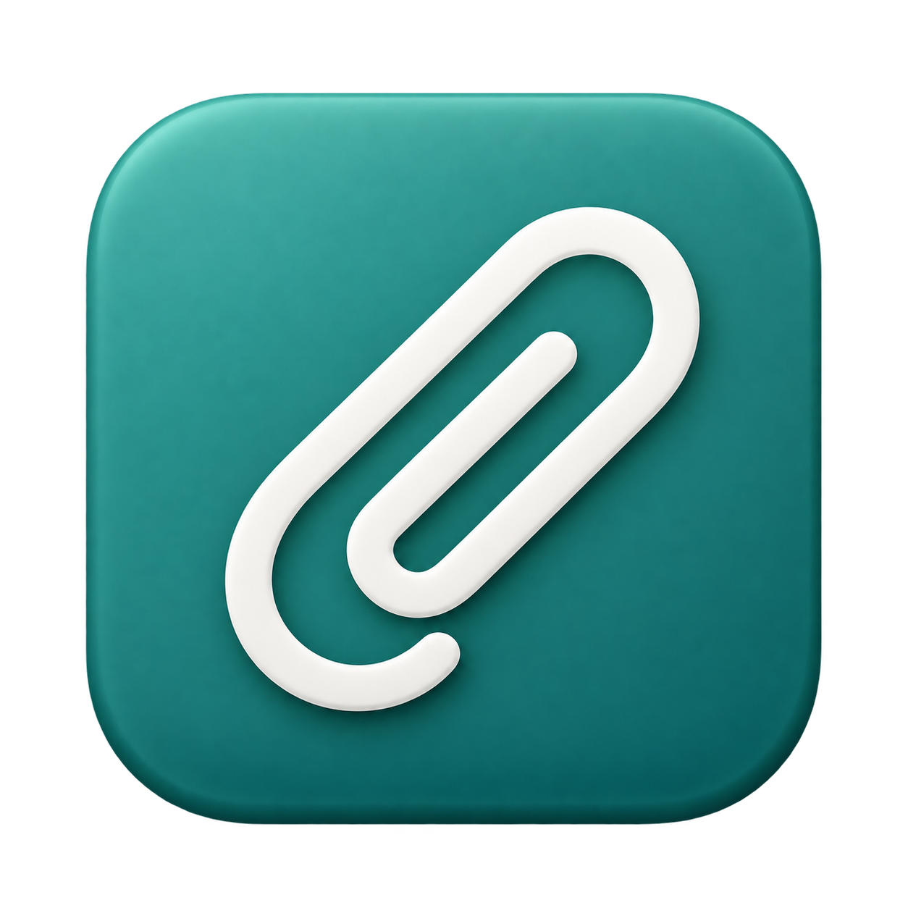
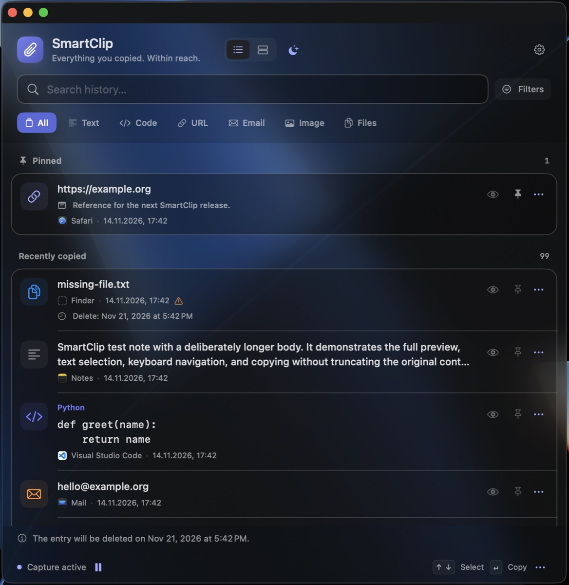
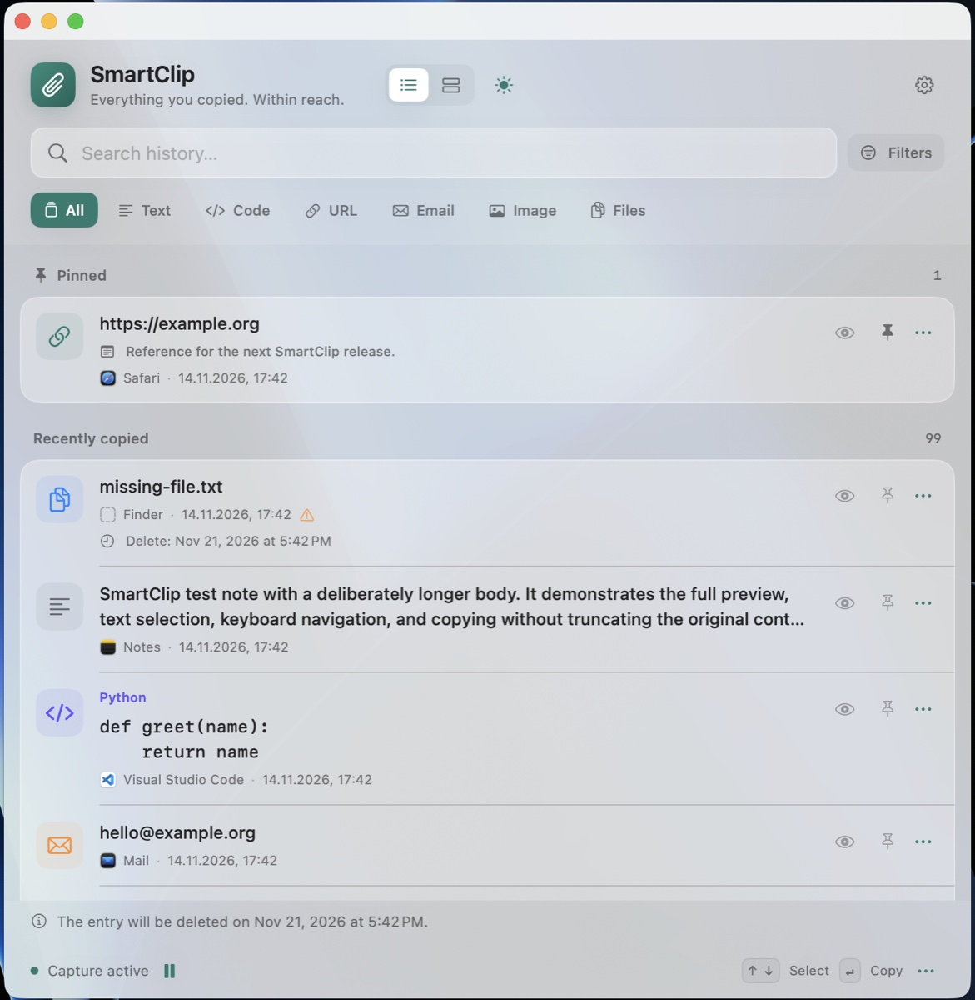
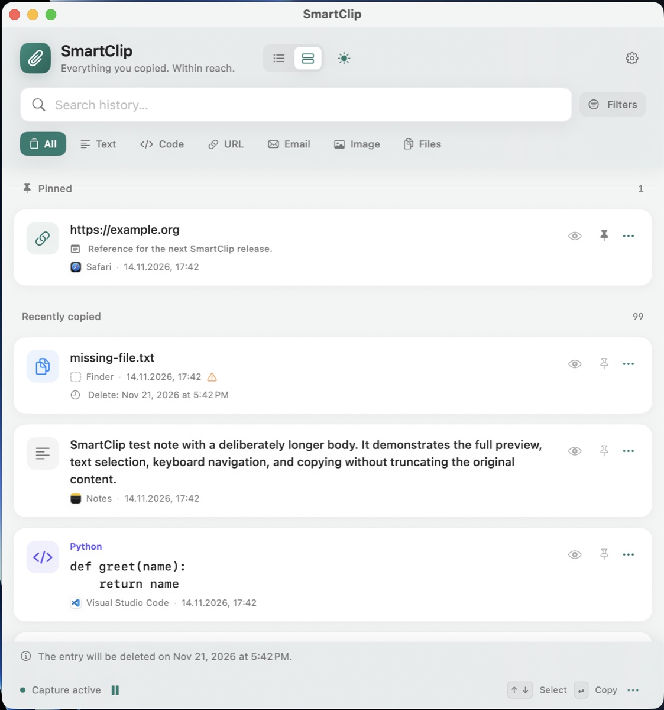
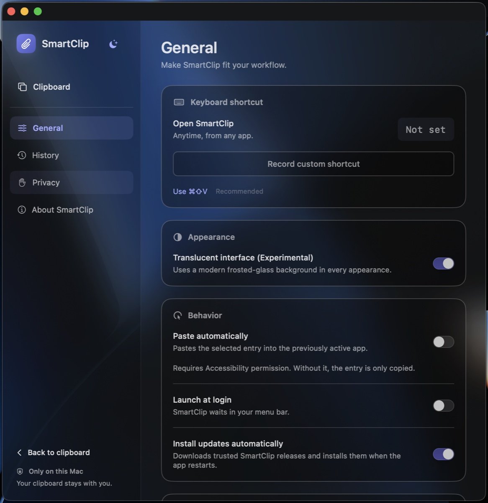
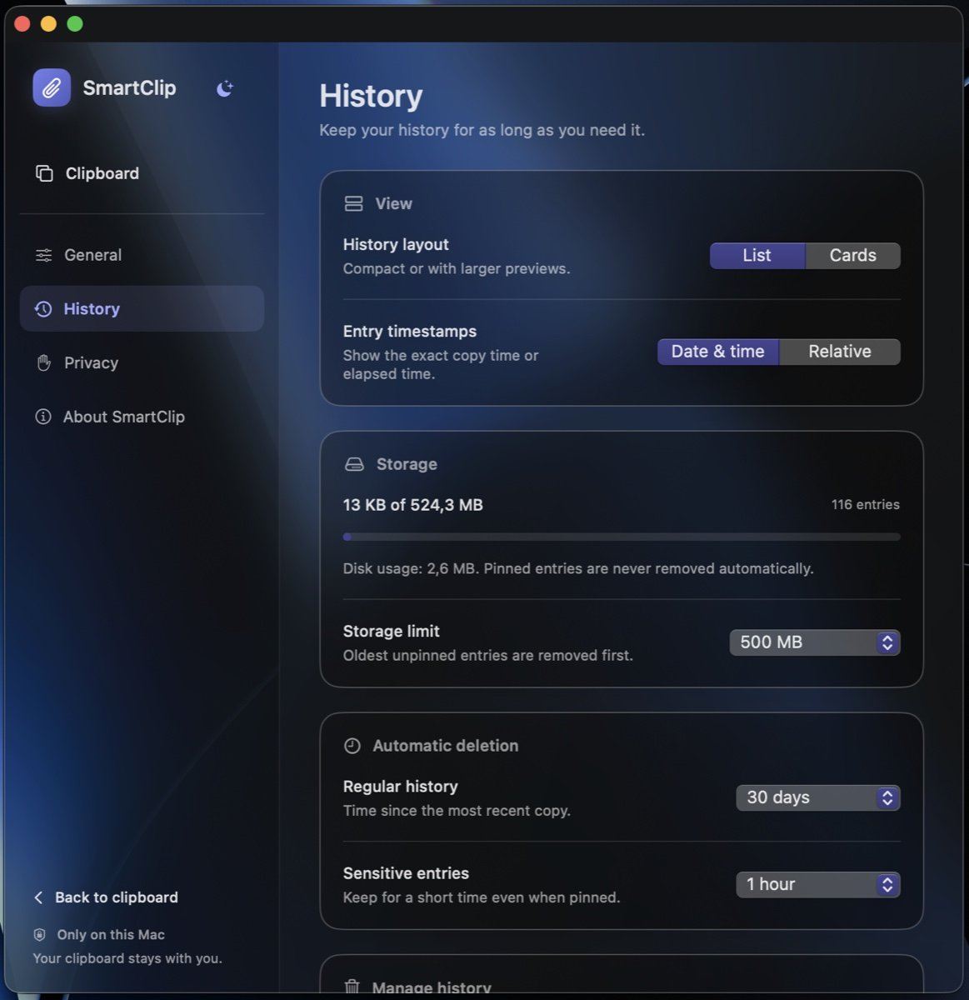
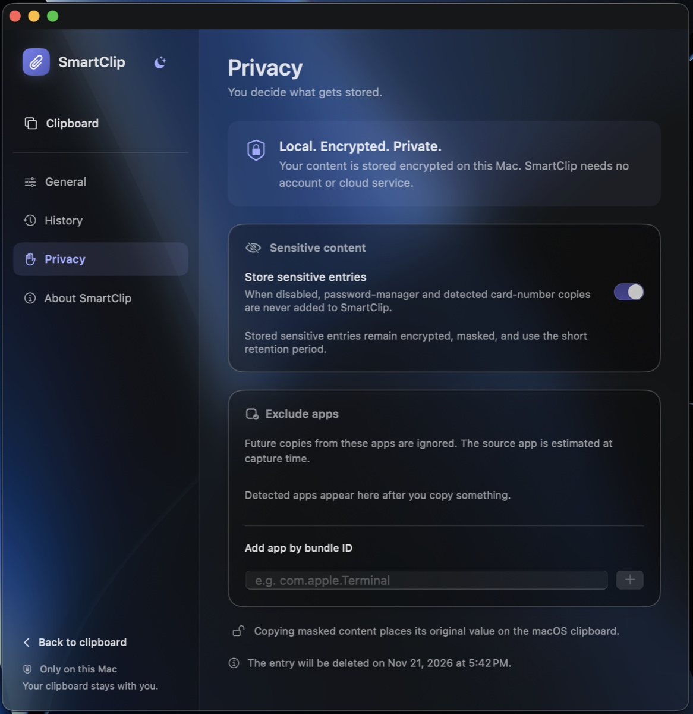
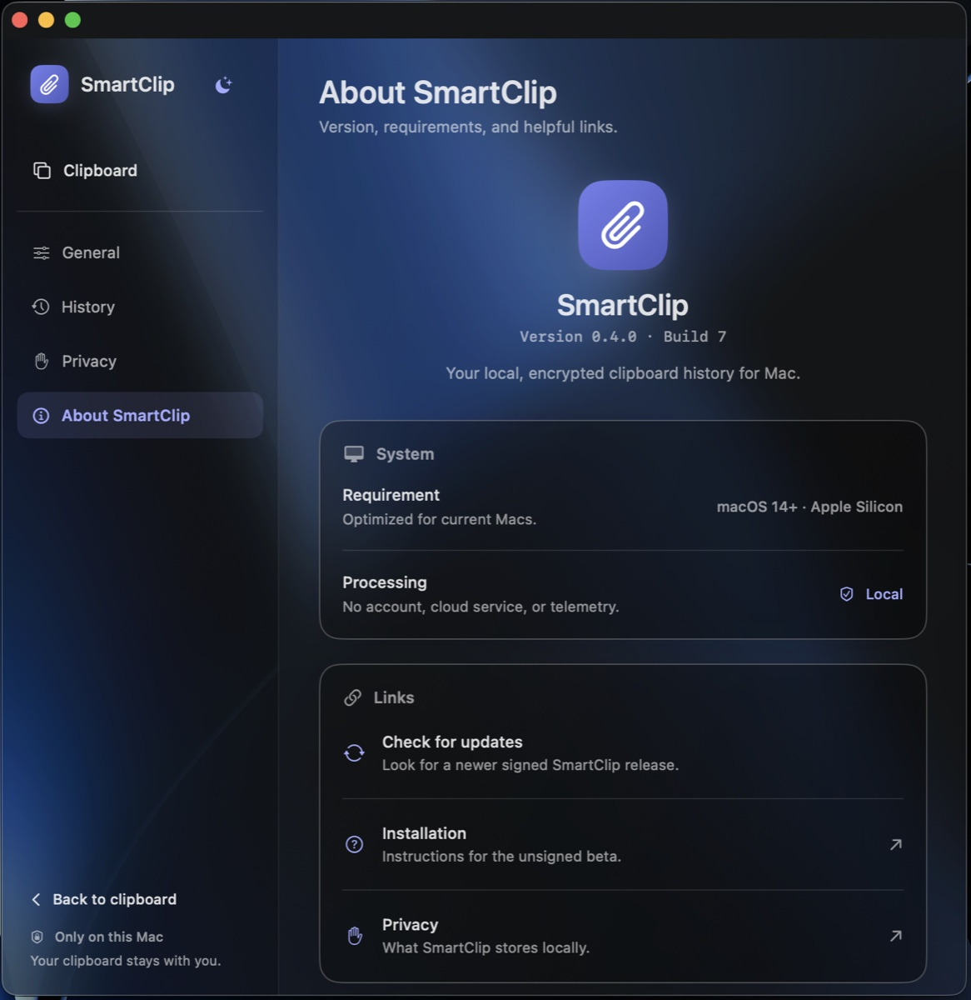

# SmartClip

<p align="center">
  <a href="README.md">English</a> · <a href="README-DE.md">Deutsch</a> · <a href="README-ZH.md">中文</a> · <strong>日本語</strong> · <a href="README-KO.md">한국어</a>
</p>

<div align="center">
  

  **macOS に自然になじむ、プライベートで暗号化されたクリップボード履歴。**

  [](https://github.com/reathloo/smartClip/actions/workflows/ci.yml)
  [](https://github.com/reathloo/smartClip/releases)
  
  
  [](LICENSE)

  [スクリーンショット](#スクリーンショット) · [機能](#機能) · [インストール](#インストール) · [プライバシー設計](#プライバシー設計) · [開発](#開発) · [コントリビューション](CONTRIBUTING.md) · [セキュリティ](SECURITY.md)
</div>

SmartClip はメニューバーに常駐し、コピーしたテキスト、リンク、コード、
画像、ファイル参照をすぐに取り出せるようにします。アカウント、クラウド
サービス、テレメトリ、リモート処理を使わず、すべてを Mac 内に保持します。

## スクリーンショット

SmartClip はライト／ダーク表示、リスト／カードレイアウト、オプションの
実験的な半透明インターフェイスに対応しています。

<p align="center">
  
</p>

| ライト・リスト表示 | ライト・カード表示 |
| --- | --- |
|  |  |

| 一般設定 | 履歴設定 |
| --- | --- |
|  |  |

| プライバシー設定 | SmartClip について／アップデート |
| --- | --- |
|  |  |

## SmartClip を選ぶ理由

- **初期状態からプライベート。** クリップボードの内容を AES-GCM で暗号化し、
  鍵を macOS キーチェーンに保存します。
- **すぐに呼び出せる。** メニューバーまたは設定可能なグローバルショート
  カットから履歴を開き、作業を中断せずに検索、コピーできます。
- **macOS ネイティブ。** SwiftUI と AppKit で構築し、ライト／ダークモード、
  ログイン時の起動、ネイティブなキーボード操作、アクセシビリティ権限を
  考慮した自動ペーストに対応します。
- **多言語インターフェース。** macOS のアプリごとの優先言語に従い、英語、
  ドイツ語、簡体字中国語、日本語、韓国語で表示します。
- **機密データを慎重に扱う。** 非表示クリップボードマーカー、有効なカード
  番号、一般的な認証情報形式をマスクし、保持期間を短くします。

## 機能

| 履歴 | ワークフロー | プライバシーと制御 |
| --- | --- | --- |
| テキスト、URL、メール、コード、画像、ファイル参照 | 種類、期間、コピー元アプリ、お気に入りで検索 | ローカルで暗号化された内容 |
| 重複処理とコピー元アプリの推定 | キーボード操作、ドラッグ＆ドロップ、絶対／相対時刻、自動ペースト | 機密コンテンツのマスクまたは完全除外 |
| プレビューでファイル形式、サイズ、更新情報を表示 | 暗号化メモ、名前付きお気に入り、項目ごとの保持期間 | 取得の一時停止、権限確認、除外アプリ |
| 自動クリーンアップとストレージ上限 | メニューバーの状態表示とログイン時の起動 | お気に入りを残すクリーンアップとテレメトリなし |

> [!NOTE]
> SmartClip はファイルそのものではなく、ファイルへの参照を保存します。
> コピー元アプリ、コード、機密コンテンツの検出はベストエフォートであり、
> すべてのケースを検出できるわけではありません。

## インストール

現在 SmartClip は **macOS 14 以降を搭載した Apple Silicon Mac** に対応しています。

1. [GitHub Releases](https://github.com/reathloo/smartClip/releases) から最新の DMG をダウンロードします。
2. DMG を開き、**SmartClip** を **アプリケーション** フォルダへドラッグします。
3. SmartClip を起動し、短い初期設定を完了します。

> [!WARNING]
> 現在の無料リリースは Apple Developer ID で署名されておらず、公証も
> されていません。初回起動時に **システム設定 → プライバシーとセキュリティ
> → このまま開く** から許可してください。手順は
> [インストールガイド](docs/INSTALLATION.md)を参照してください。

公開ビルドは署名済みの SmartClip アップデートフィードを1時間ごとに確認
します。信頼済みのアップデートはバックグラウンドでダウンロードされ、
SmartClip の再起動時にインストールできます。設定で自動インストールを
無効にするか、いつでも **アップデートを確認…** を選択できます。

## プライバシー設計

SmartClip はメタデータにローカルの SQLite データベースを使用し、
クリップボード内容を AES-GCM で暗号化します。暗号鍵はキーチェーンに保存
されます。機密項目はマスクされたまま全文検索から除外され、お気に入りに
しても短い期間で期限切れになります。検出した機密コンテンツを一切保存
しないように設定することもできます。

履歴を整理するため、種類、タイムスタンプ、推定コピー元アプリ名などの
一部メタデータは暗号化されません。機密データに SmartClip を使用する前に、
完全な[プライバシー説明](PRIVACY.md)をお読みください。

## 開発

必要な環境：

- macOS 14 以降
- Xcode または Command Line Tools の Swift 6 ツールチェーン

```sh
git clone https://github.com/reathloo/smartClip.git
cd smartClip
zsh scripts/run-dev.sh --check
```

主なコマンド：

```sh
zsh scripts/run-dev.sh          # 実際のアプリをビルドして再起動
zsh scripts/run-dev.sh --ui     # サンプルデータを使った分離 UI プレビュー
zsh scripts/test.sh             # 143 件のコアチェックをすべて実行
zsh scripts/build-app.sh        # dist/SmartClip.app を作成
```

UI プレビューは専用のペーストボードと分離された一時データを使用します。
キーチェーン、アクセシビリティ、グローバルショートカット、ログイン時の
起動を含む統合テストでのみ実際のアプリを使用してください。

## リリース手順

`v*` タグをプッシュするとリリースワークフローが起動します。チェックを
実行し、デザイン済み DMG の作成とパッケージ検証を行い、Sparkle EdDSA で
アップデートに署名して GitHub Release を作成し、GitHub Pages から appcast
を公開します。

```sh
zsh scripts/package-release.sh v0.5.0
```

詳しくは[リリースガイド](docs/RELEASE.md)、[テストレポート](docs/TEST_REPORT.md)、
[サードパーティ通知](THIRD_PARTY_NOTICES.md)を参照してください。
