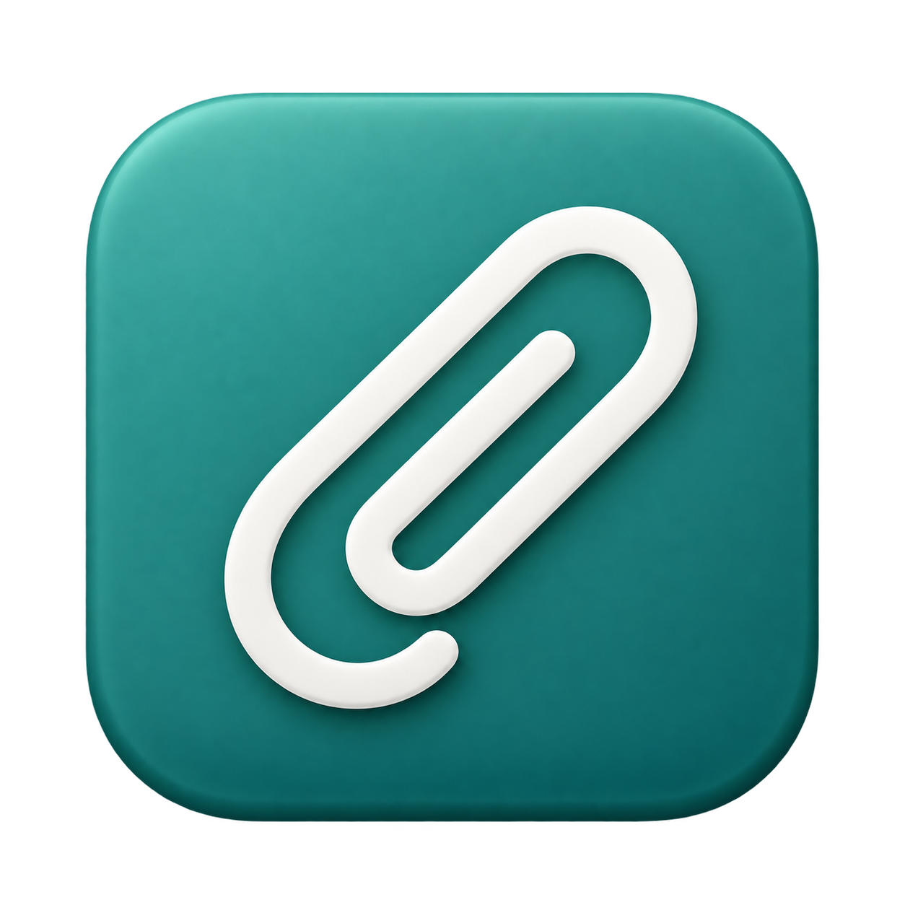
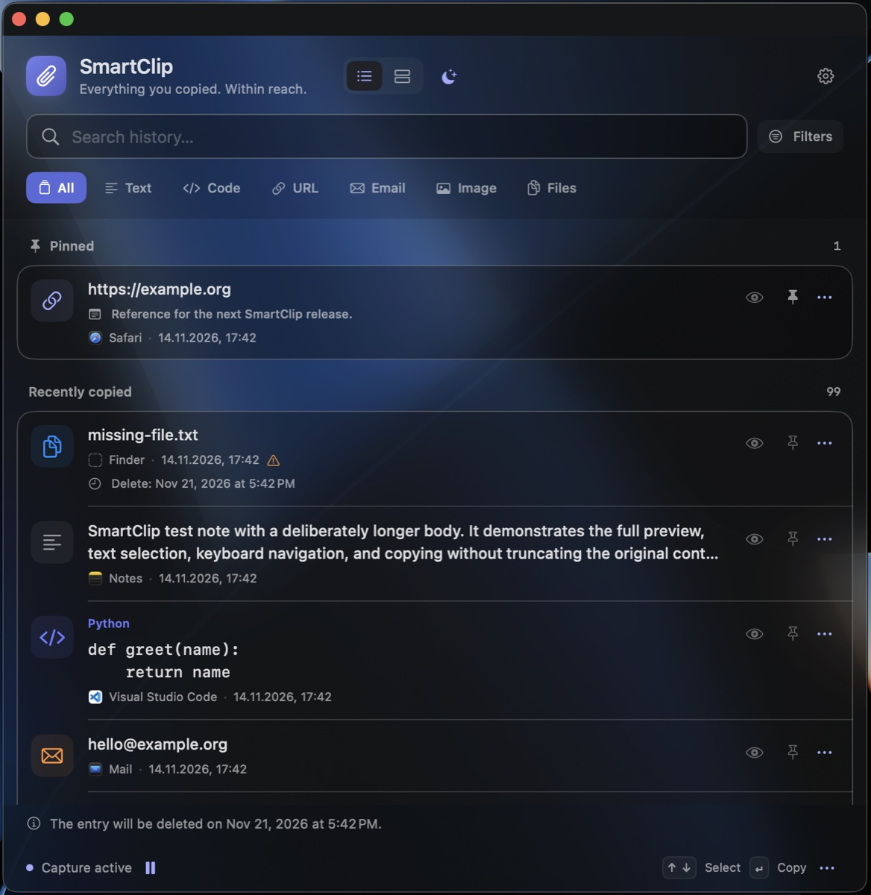
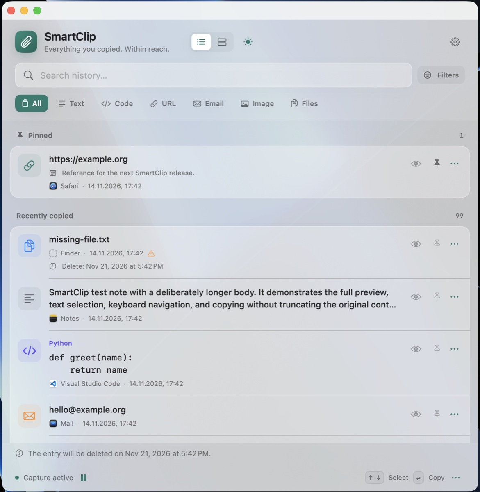
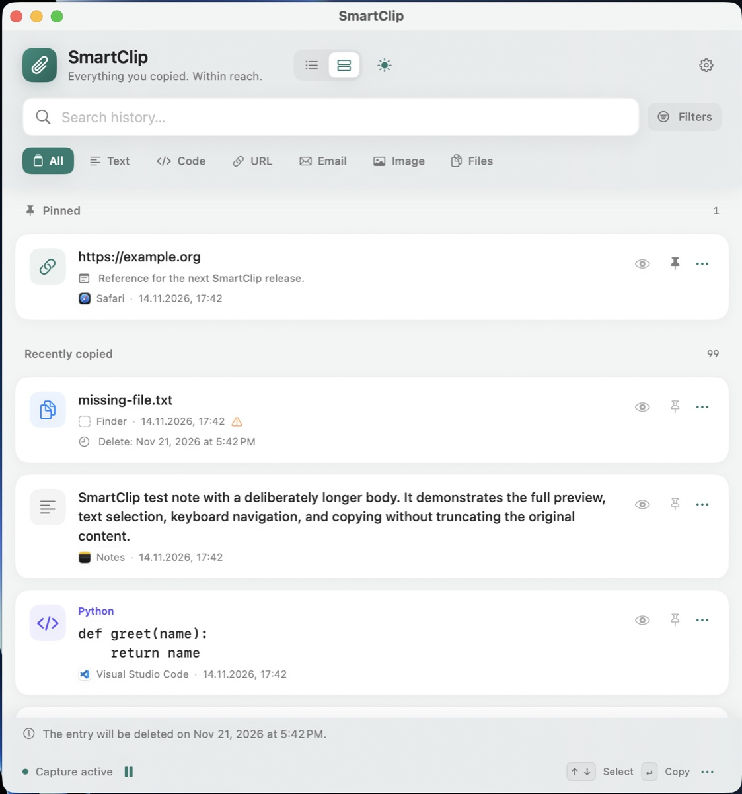
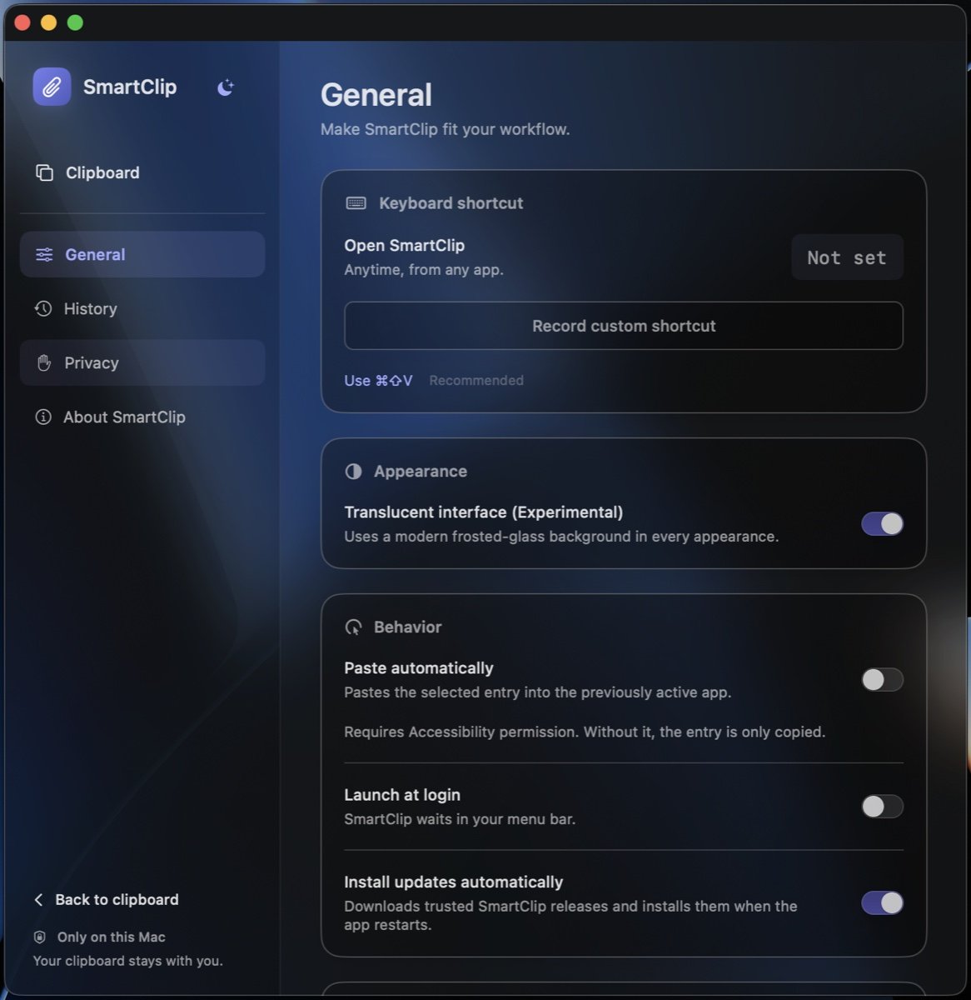
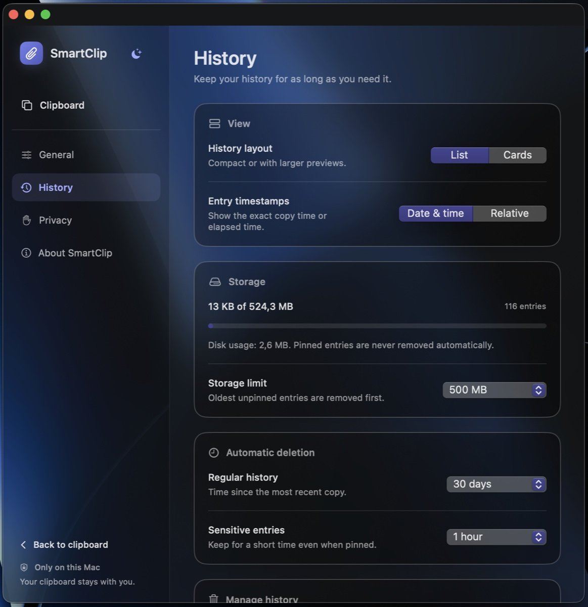
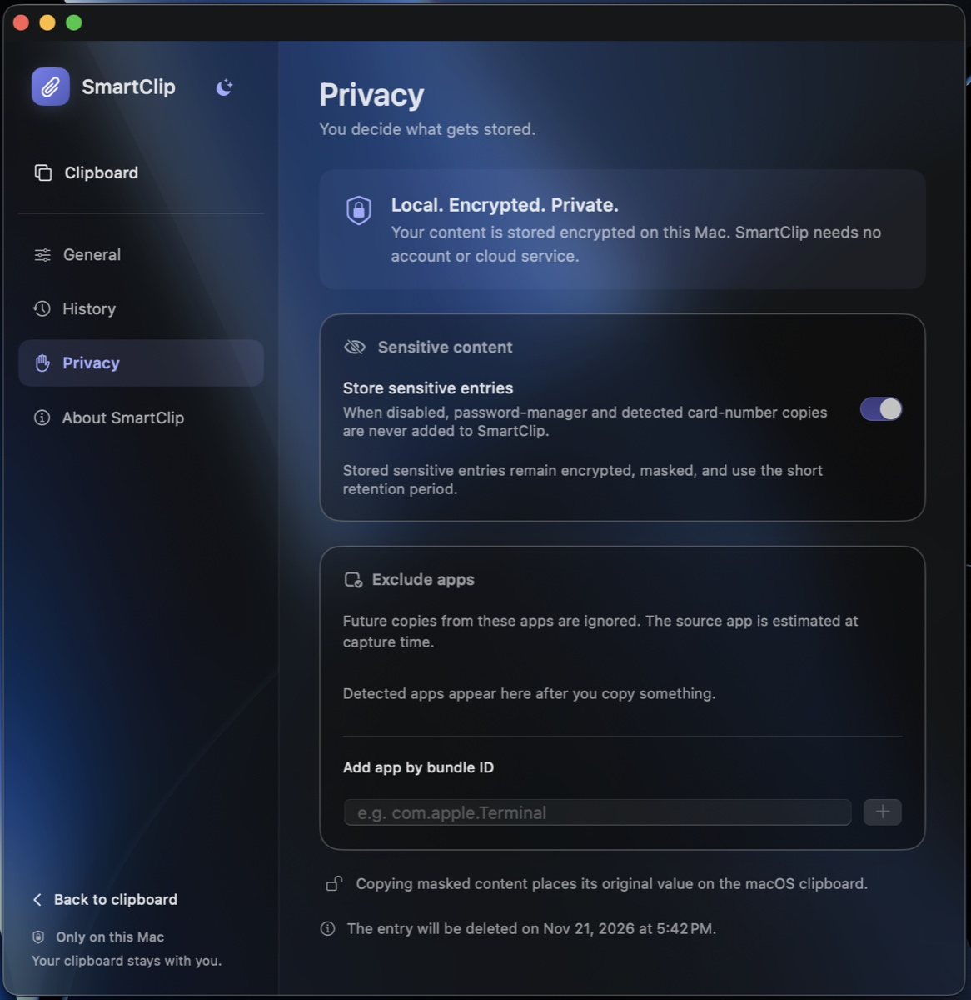
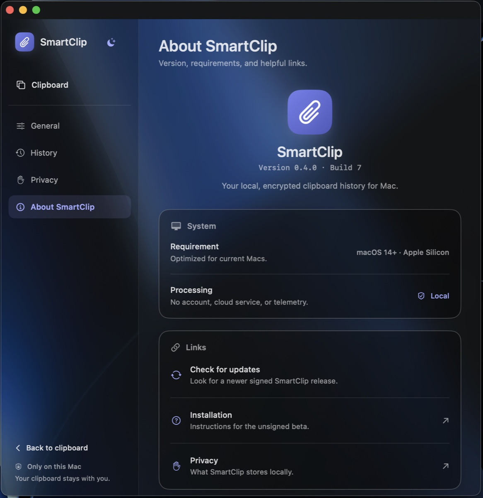

# SmartClip

<p align="center">
  <a href="README.md">English</a> · <a href="README-DE.md">Deutsch</a> · <a href="README-ZH.md">中文</a> · <a href="README-JA.md">日本語</a> · <strong>한국어</strong>
</p>

<div align="center">
  

  **macOS에 자연스럽게 어울리는 비공개 암호화 클립보드 기록 도구.**

  [](https://github.com/reathloo/smartClip/actions/workflows/ci.yml)
  [](https://github.com/reathloo/smartClip/releases)
  
  
  [](LICENSE)

  [스크린샷](#스크린샷) · [기능](#기능) · [설치](#설치) · [개인정보 보호 설계](#개인정보-보호-설계) · [개발](#개발) · [기여](CONTRIBUTING.md) · [보안](SECURITY.md)
</div>

SmartClip은 메뉴 막대에 상주하며 복사한 텍스트, 링크, 코드, 이미지와 파일
참조를 바로 꺼내 쓸 수 있게 합니다. 계정, 클라우드 서비스, 원격 측정 또는
원격 처리 없이 모든 내용을 Mac에 보관합니다.

## 스크린샷

SmartClip은 라이트 및 다크 모드, 목록 및 카드 레이아웃, 선택 가능한 실험적
반투명 인터페이스를 지원합니다.

<p align="center">
  
</p>

| 라이트 목록 레이아웃 | 라이트 카드 레이아웃 |
| --- | --- |
|  |  |

| 일반 설정 | 기록 설정 |
| --- | --- |
|  |  |

| 개인정보 보호 설정 | 정보 및 업데이트 |
| --- | --- |
|  |  |

## SmartClip을 선택하는 이유

- **기본적으로 비공개.** 클립보드 내용을 AES-GCM으로 암호화하고 키를 macOS
  키체인에 저장합니다.
- **빠른 접근.** 메뉴 막대 또는 설정 가능한 전역 단축키로 기록을 열어 현재
  작업 흐름을 벗어나지 않고 검색하고 복사할 수 있습니다.
- **macOS 네이티브.** SwiftUI와 AppKit으로 제작되어 라이트 및 다크 모드,
  로그인 시 실행, 네이티브 키보드 조작과 손쉬운 사용 권한을 고려한 자동
  붙여넣기를 지원합니다.
- **다국어 인터페이스.** macOS의 앱별 선호 언어에 따라 영어, 독일어,
  중국어 간체, 일본어 또는 한국어로 표시됩니다.
- **민감한 데이터를 신중하게 처리.** 숨겨진 클립보드 표시, 유효한 카드 번호,
  일반적인 자격 증명 형식을 가리고 더 짧은 보존 기간을 적용합니다.

## 기능

| 기록 | 작업 흐름 | 개인정보 보호 및 제어 |
| --- | --- | --- |
| 텍스트, URL, 이메일, 코드, 이미지 및 파일 참조 | 유형, 시간, 원본 앱 및 즐겨찾기로 검색 | 암호화된 로컬 콘텐츠 |
| 중복 처리 및 원본 앱 추정 | 키보드 조작, 드래그 앤 드롭, 정확한 또는 상대적 시간 표시 및 자동 붙여넣기 | 민감한 콘텐츠 가리기 또는 완전 제외 |
| 미리보기에서 파일 유형, 크기 및 수정 정보 표시 | 암호화된 메모, 이름을 지정한 즐겨찾기 및 항목별 보존 기간 | 캡처 일시 중지, 권한 확인 및 제외 앱 |
| 자동 정리 및 저장 공간 제한 | 메뉴 막대 상태 및 로그인 시 실행 | 즐겨찾기를 유지하는 정리 및 원격 측정 없음 |

> [!NOTE]
> SmartClip은 파일을 복사하는 대신 파일 참조를 저장합니다. 원본 앱, 코드 및
> 민감한 콘텐츠 감지는 최선형 방식이므로 모든 경우를 감지한다고 보장하지
> 않습니다.

## 설치

SmartClip은 현재 **macOS 14 이상을 실행하는 Apple Silicon Mac**을 지원합니다.

1. [GitHub Releases](https://github.com/reathloo/smartClip/releases)에서 최신 DMG를 다운로드합니다.
2. DMG를 열고 **SmartClip**을 **응용 프로그램** 폴더로 드래그합니다.
3. SmartClip을 실행하고 간단한 초기 설정을 완료합니다.

> [!WARNING]
> 현재 무료 릴리스는 Apple Developer ID로 서명되거나 공증되지 않았습니다.
> 처음 실행할 때 **시스템 설정 → 개인정보 보호 및 보안 → 확인 없이 열기**에서
> SmartClip 실행을 허용해야 합니다. 전체 단계는
> [설치 안내](docs/INSTALLATION.md)를 참조하세요.

배포된 빌드는 서명된 SmartClip 업데이트 피드를 한 시간마다 확인합니다.
신뢰할 수 있는 업데이트는 백그라운드에서 다운로드되고 SmartClip을 다시
시작할 때 설치될 수 있습니다. 설정에서 자동 설치를 끄거나 언제든지
**업데이트 확인…**을 선택할 수 있습니다.

## 개인정보 보호 설계

SmartClip은 메타데이터에 로컬 SQLite 데이터베이스를 사용하고 클립보드
내용을 AES-GCM으로 암호화합니다. 암호화 키는 키체인에 보관됩니다. 민감한
항목은 가려진 상태로 유지되고 전체 텍스트 검색에서 제외되며, 고정된
경우에도 더 빨리 만료됩니다. 감지된 민감한 클립보드 내용을 저장하지 않도록
SmartClip을 설정할 수도 있습니다.

기록을 정리하는 데 필요한 유형, 타임스탬프, 추정 원본 앱 이름 등의 일부
메타데이터는 암호화되지 않습니다. 민감한 데이터에 SmartClip을 사용하기 전에
전체 [개인정보 보호 설명](PRIVACY.md)을 읽어 주세요.

## 개발

필수 환경:

- macOS 14 이상
- Xcode 또는 Command Line Tools의 Swift 6 도구 체인

```sh
git clone https://github.com/reathloo/smartClip.git
cd smartClip
zsh scripts/run-dev.sh --check
```

유용한 명령:

```sh
zsh scripts/run-dev.sh          # 실제 앱을 빌드하고 다시 시작
zsh scripts/run-dev.sh --ui     # 샘플 데이터가 포함된 격리된 UI 미리보기
zsh scripts/test.sh             # 코어 검사 143개 모두 실행
zsh scripts/build-app.sh        # dist/SmartClip.app 생성
```

UI 미리보기는 별도의 클립보드와 격리된 임시 데이터를 사용합니다. 키체인,
손쉬운 사용, 전역 단축키 또는 로그인 시 실행과 관련된 통합 테스트에만 실제
앱을 사용하세요.

## 릴리스 과정

`v*` 태그를 푸시하면 릴리스 워크플로가 시작됩니다. 검사 실행, 디자인된 DMG
빌드, 패키지 검증, Sparkle EdDSA를 사용한 업데이트 서명, GitHub Release 생성,
GitHub Pages를 통한 appcast 게시를 수행합니다.

```sh
zsh scripts/package-release.sh v0.4.0
```

전체 내용은 [릴리스 안내](docs/RELEASE.md), [테스트 보고서](docs/TEST_REPORT.md),
[서드파티 고지](THIRD_PARTY_NOTICES.md)를 참조하세요.
