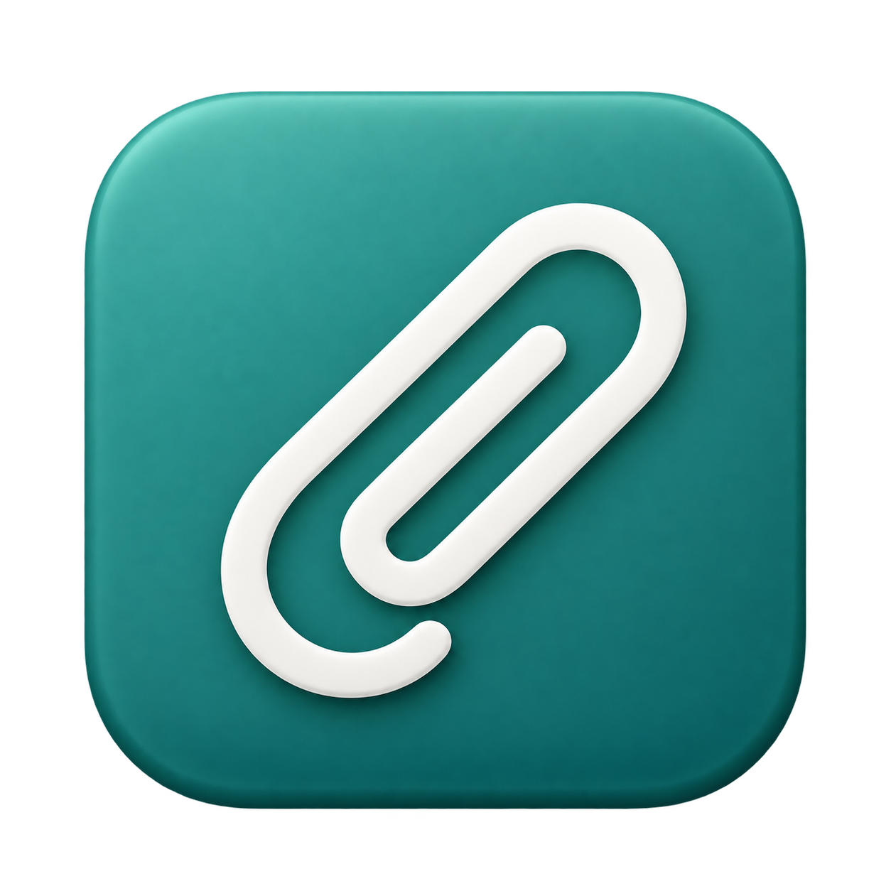
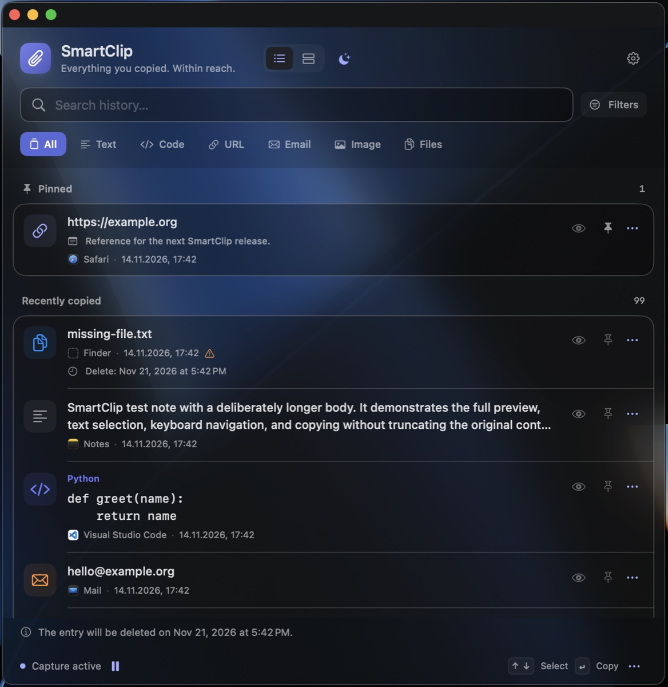
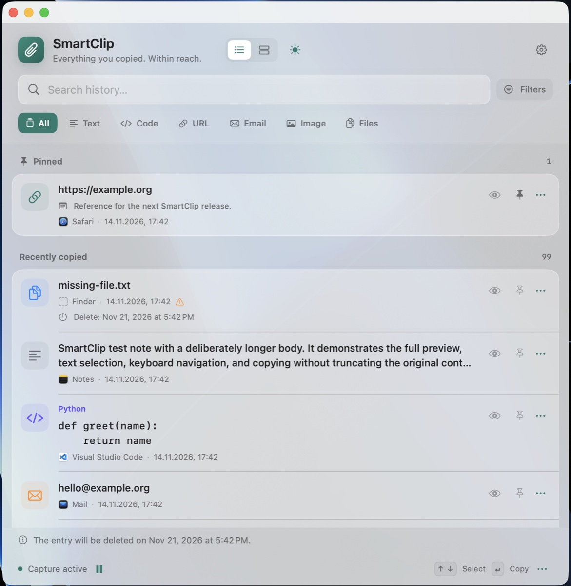
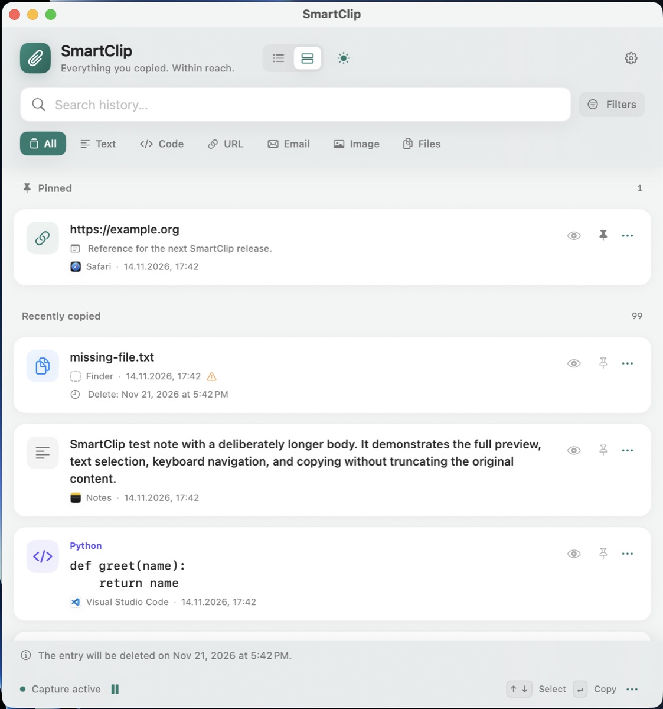
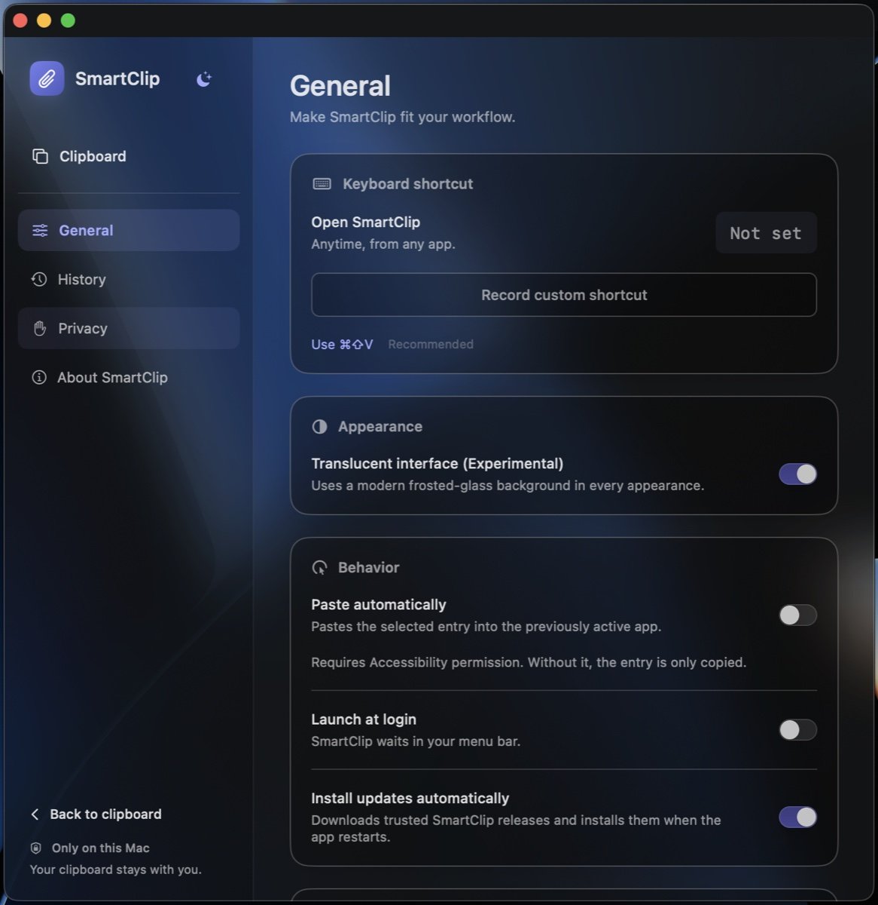
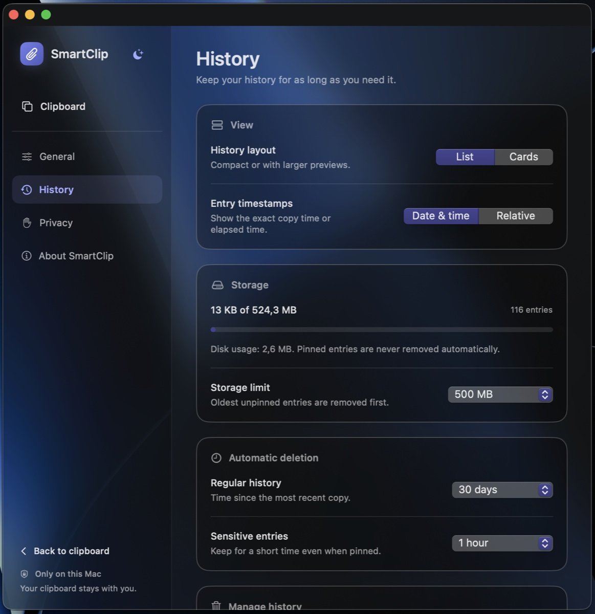
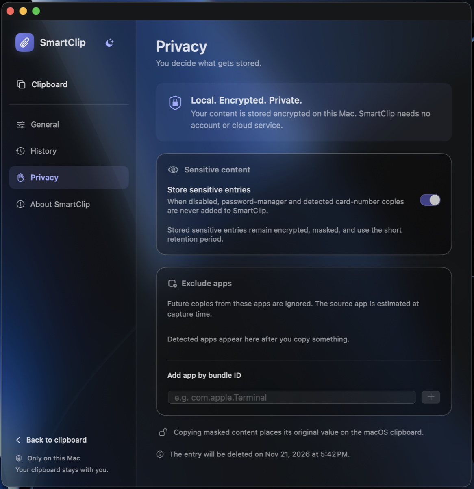
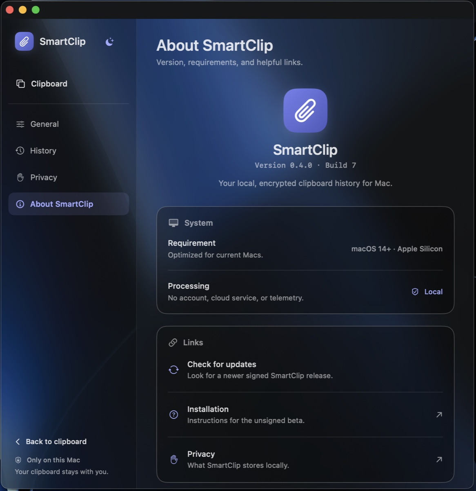

# SmartClip

<p align="center">
  <a href="README.md">English</a> · <a href="README-DE.md">Deutsch</a> · <strong>中文</strong> · <a href="README-JA.md">日本語</a> · <a href="README-KO.md">한국어</a>
</p>

<div align="center">
  

  **一款贴合 macOS 使用体验的私密加密剪贴板历史工具。**

  [](https://github.com/reathloo/smartClip/actions/workflows/ci.yml)
  [](https://github.com/reathloo/smartClip/releases)
  
  
  [](LICENSE)

  [截图](#截图) · [功能](#功能) · [安装](#安装) · [隐私设计](#隐私设计) · [开发](#开发) · [参与贡献](CONTRIBUTING.md) · [安全](SECURITY.md)
</div>

SmartClip 常驻菜单栏，让复制过的文本、链接、代码、图片和文件引用随手
可取。所有内容都留在你的 Mac 上：无需账户，不使用云服务、遥测或远程
处理。

## 截图

SmartClip 支持浅色和深色外观、列表和卡片布局，以及可选的实验性半透明
界面。

<p align="center">
  
</p>

| 浅色列表布局 | 浅色卡片布局 |
| --- | --- |
|  |  |

| 常规设置 | 历史设置 |
| --- | --- |
|  |  |

| 隐私设置 | 关于与更新 |
| --- | --- |
|  |  |

## 为什么选择 SmartClip？

- **默认保护隐私。** 剪贴板内容使用 AES-GCM 加密，密钥存储在 macOS
  钥匙串中。
- **随时快速调用。** 通过菜单栏或可配置的全局快捷键打开历史记录，直接
  搜索和复制，不打断当前工作流。
- **原生 macOS 体验。** 使用 SwiftUI 和 AppKit 构建，支持浅色和深色模式、
  登录时启动、原生键盘操作，以及适配辅助功能权限的自动粘贴。
- **多语言界面。** 根据 macOS 的首选应用语言显示英语、德语、简体中文、
  日语或韩语。
- **谨慎处理敏感数据。** 隐藏剪贴板标记、有效银行卡号和常见凭据格式会
  被遮盖，并采用更短的保留期限。

## 功能

| 历史记录 | 工作流 | 隐私与控制 |
| --- | --- | --- |
| 文本、URL、电子邮件、代码、图片和文件引用 | 按类型、时间、来源应用和收藏进行搜索 | 本地加密存储内容 |
| 重复内容处理和来源应用推测 | 键盘操作、拖放、精确或相对时间戳以及自动粘贴 | 遮盖或完全排除敏感内容 |
| 在预览中显示文件类型、大小和修改信息 | 加密备注、命名收藏和单条记录保留期限 | 暂停采集、权限检查和排除应用 |
| 自动清理和存储上限 | 菜单栏状态和登录时启动 | 清理时保留收藏且无遥测 |

> [!NOTE]
> SmartClip 保存文件引用，而不是复制文件本身。来源应用、代码和敏感内容
> 检测均为尽力而为，不能保证识别所有情况。

## 安装

SmartClip 目前支持运行 **macOS 14 或更高版本的 Apple Silicon Mac**。

1. 从 [GitHub Releases](https://github.com/reathloo/smartClip/releases) 下载最新 DMG。
2. 打开 DMG，将 **SmartClip** 拖入 **应用程序** 文件夹。
3. 启动 SmartClip 并完成简短设置。

> [!WARNING]
> 当前免费版本未使用 Apple Developer ID 签名，也未经过公证。首次启动时，
> 需要前往 **系统设置 → 隐私与安全性 → 仍要打开**。完整步骤请参阅
> [安装指南](docs/INSTALLATION.md)。

发布版本每小时检查一次已签名的 SmartClip 更新源。可信更新可以在后台
下载，并在 SmartClip 重启时安装。你可以在设置中关闭自动安装，或随时
选择 **检查更新…**。

## 隐私设计

SmartClip 使用本地 SQLite 数据库存储元数据，并使用 AES-GCM 加密剪贴板
内容。加密密钥保存在钥匙串中。敏感记录始终保持遮盖状态，不参与全文
搜索，即使已固定也会更早过期。你还可以设置 SmartClip 永不保存检测到的
敏感剪贴板内容。

为便于组织历史记录，类型、时间戳和推测的来源应用名称等部分元数据仍会
以未加密形式保存。在使用 SmartClip 处理敏感数据前，请阅读完整的
[隐私说明](PRIVACY.md)。

## 开发

环境要求：

- macOS 14 或更高版本
- 来自 Xcode 或 Command Line Tools 的 Swift 6 工具链

```sh
git clone https://github.com/reathloo/smartClip.git
cd smartClip
zsh scripts/run-dev.sh --check
```

常用命令：

```sh
zsh scripts/run-dev.sh          # 构建并重新启动真实应用
zsh scripts/run-dev.sh --ui     # 使用示例数据运行隔离的界面预览
zsh scripts/test.sh             # 运行全部 143 项核心检查
zsh scripts/build-app.sh        # 创建 dist/SmartClip.app
```

界面预览使用独立剪贴板和隔离的临时数据。只有在测试钥匙串、辅助功能、全局
快捷键或登录时启动等系统集成时，才使用真实应用。

## 发布流程

推送 `v*` 标签会触发发布工作流。工作流会运行检查、构建带样式的 DMG、
验证软件包、使用 Sparkle EdDSA 签名更新、创建 GitHub Release，并通过
GitHub Pages 发布 appcast。

```sh
zsh scripts/package-release.sh v0.5.0
```

完整信息请参阅[发布指南](docs/RELEASE.md)、[测试报告](docs/TEST_REPORT.md)
和[第三方声明](THIRD_PARTY_NOTICES.md)。
