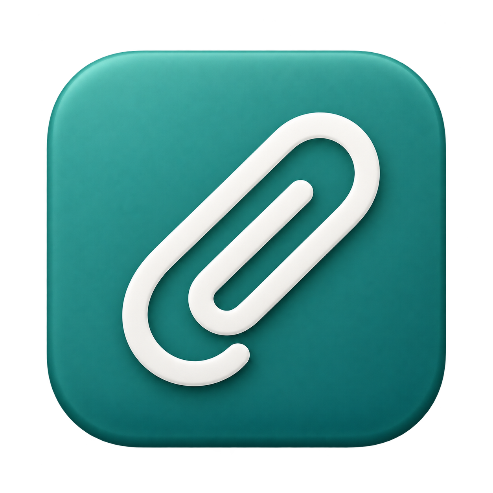

# SmartClip



A local, encrypted clipboard history for **macOS 14+**. SmartClip lives in the menu bar and works without an account, cloud service, or telemetry.

## Features

- Text, links, email addresses, images, file references, and code detection.
- Search, type filters, named favorites, and list or card views.
- Configurable global shortcut, optional launch at login, and direct paste.
- Per-entry retention, automatic cleanup, and masked sensitive content.
- Capture pauses, excluded apps, and light or dark appearance.

## Install

The free beta is an unsigned DMG for Apple Silicon. On first launch, macOS requires one confirmation under **System Settings → Privacy & Security → Open Anyway**. See the [installation guide](docs/INSTALLATION.md).

## Fast local testing

Requires a compatible Swift toolchain from Xcode or the Command Line Tools.

```sh
zsh scripts/run-dev.sh          # build and restart the real app
zsh scripts/run-dev.sh --ui     # isolated UI preview with sample data
zsh scripts/run-dev.sh --check  # run all checks, then restart the app
```

Use `--ui` for visual changes because it avoids clipboard, Keychain, hotkey, and login-item side effects. Use the real app for integration checks. The isolated suite currently contains **113 automated checks**. See the [test report](docs/TESTBERICHT.md) for coverage and remaining system tests.

## Release build

Create the unsigned beta package with:

```sh
zsh scripts/package-release.sh v0.1.0-beta.1
```

## Notes

Files remain references to their originals, images above 20 MB are skipped, and code or sensitive-content detection is heuristic. Retention removes SmartClip history entries, not the current macOS clipboard. See [privacy](PRIVACY.md) and the [release process](docs/RELEASE.md).
